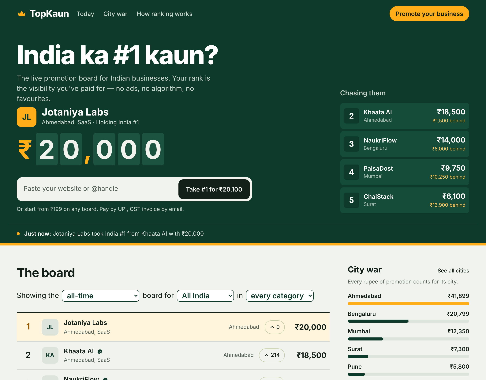

# TopKaun — India ka #1 kaun?

The live **promotion & marketing platform** for Indian businesses. A public
leaderboard where a business buys promoted placement, and the price of each rank
is set by a live auction: **your rank = the promotion you've paid for.**

No ads, no algorithm, no favourites — and it's advertising, not a game of chance.



## Quick start

```bash
pnpm install
pnpm dev     # open http://localhost:3000
```

Runs in **demo mode** out of the box — sample businesses and instant mock
payments, so the whole experience is clickable with no accounts or keys.

## What's inside

- **The board** (`/`) — live scoreboard, filters (all-time / today / favourite ×
  city × category), hype, City War sidebar, watch alerts.
- **Promote** (`/promote`) — the claim → pay flow (mock today, real Razorpay when
  keys are set).
- **Listing** (`/l/[slug]`) — a business's public profile and where it ranks.
- **City War** (`/cities`) — cities ranked by total promotion; Ahmedabad vs Surat.
- **Legal** — `/rules`, `/terms`, `/privacy`, `/refunds`.

## Docs

- **`CLAUDE.md`** — project brief + architecture + the all-important legal framing.
- **`DEPLOY.md`** — plain-language, step-by-step guide to going live.
- **`docs/GO-TO-MARKET.md`** — the launch & growth playbook (Ahmedabad beachhead).

## Stack

Next.js 15 · React 19 · TypeScript · Tailwind v4 · Razorpay · Supabase (planned)
· deploy on Vercel.

## Tech scripts

```bash
pnpm dev      # dev server
pnpm build    # production build (keep warning-free)
pnpm start    # run the production build
pnpm lint     # lint
```
